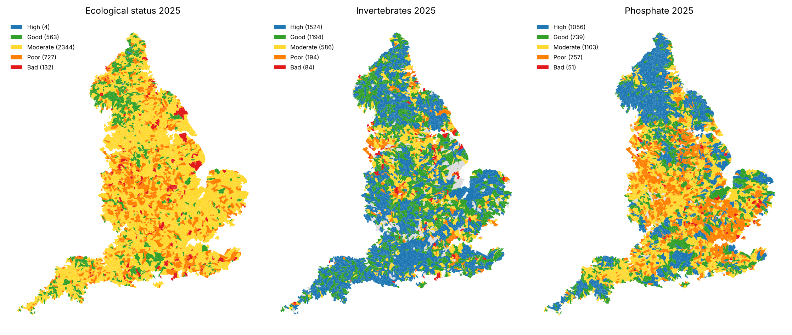

# England river health: what drives the ecological status of England's rivers?

[](https://github.com/TilakHeble/england-river-health/actions/workflows/tests.yml)

**Live dashboard:** https://england-river-health.streamlit.app/

Only 15% of England's 3,772 river water bodies reached good ecological status in the 2025 Water Framework
Directive classification. This project asks **which pressures explain why rivers fail, how much storm overflow
spills matter compared with treated sewage, farming and towns, and where cutting spills would most likely
change a river's status.** It joins five Environment Agency and Natural England open datasets on a river network
inferred from scratch, and fits decision trees, random forests, XGBoost, LightGBM and CatBoost, validated
on whole catchments held out.



## Key results

| Element (2025) | Good today | Logistic | Random forest | **LightGBM tuned, monotone** | Main drivers (SHAP, grouped) |
|---|---|---|---|---|---|
| Overall ecological status | 15% | 0.805 | 0.794 | **0.803** | urban land, natural setting, arable, sewage works |
| Invertebrates | 76% | 0.795 | 0.800 | **0.804** | urban land, natural setting, arable, overflows |
| Phosphate | 48% | 0.806 | 0.819 | **0.817** | urban land, sewage works effluent, natural setting, arable |

*ROC AUC, out of fold, 5-fold cross-validation with whole management catchments held out. Nested tuning gives
0.801 / 0.798 / 0.812. [Full benchmark](outputs/tables/benchmark.csv).*

* **Urban land is the largest pressure on every element** (25-38% of SHAP importance). Storm overflows account
  for 5-10%.
* **For phosphate, treated sewage beats overflows.** Sewage works effluent per km² of catchment carries 23% of the
  explanation, overflows 5%. A decision tree's first questions are "any built-up land upstream?" and "more than
  about 6 m³/day of treated sewage per km²?"
* **Stopping every spill** is expected to lift about 50 more water bodies to good ecological status (569 → 621),
  60 for invertebrates and 110 for phosphate. Half the invertebrate gain sits in 200 water bodies, led by the
  Calder, Aire, Irwell, Mersey and Don.
* **The model blames what the EA's investigators blame.** Its SHAP attributions predict the EA's independent
  "reasons for not achieving good" (urban AUC 0.84-0.88, sewage 0.75, overflows 0.64-0.72). Livestock is the gap.
* **Fish status is not predictable** from these pressures (AUC ≈ 0.6): barriers and habitat are missing.

Read the [executive summary](docs/executive_summary.md), the [model development document](docs/model_development_document.md)
and the [validation report](docs/validation_report.md).

## What makes it different

* **Real, current, messy public data.**
  * Six years of storm overflow returns in five layouts, with durations as hours, `hh:mm:ss` text, Excel times
    and Excel datetimes. National totals reproduce the EA's published figures to the hour.
  * The Access-database permit register.
  * A 6.9-million-polygon habitat map, sampled at 2 million points.
  * 650,000 samples from the EA's new (2025) water quality API.
* **A river network built from geometry.** The EA publishes no downstream links. They are inferred from the flow
  direction of the centrelines, and upstream areas match gauged catchments (Trent 8,240 vs 8,231 km²).
* **Honest validation.**
  * Catchment-blocked CV and nested Optuna tuning.
  * Random-fold and out-of-bag scores shown side by side, to measure their optimism.
  * Flipped test labels to prove no leakage.
* **Monotone constraints.** More spills, effluent or urban land can never raise the predicted chance of good
  status. This costs about 0.003 AUC and makes every scenario physically coherent.
* **Explanations tested against an independent reference:** the Environment Agency's own reasons for failure,
  never seen by the model.
* **An ordinal model** of the five invertebrate classes (Frank and Hall decomposition, monotone).

## Repository

```
src/river_health/   download, EDM parsing, river network, land cover, features, models, experiments
scripts/            pipeline, figures, validation, notebook builders
notebooks/          01-07 analysis: data and network -> single tree -> forest -> boosting -> SHAP -> scenarios
learn/              01-09 tree-based models from scratch, on this data
app/                Streamlit dashboard (reads outputs/tables; no fitting at runtime)
docs/               executive summary, model development document, validation report
outputs/            tables, figures and fitted champion models
tests/              unit tests on synthetic data (grid refs, durations, network, folds, monotonicity, scenarios)
```

## Learn: tree-based models from scratch

[`learn/`](learn/README.md) builds the ideas up on the project's data, checking each against the library:
* Gini and the best split;
* a 40-line decision tree that matches scikit-learn exactly;
* cost-complexity pruning;
* bagging and the ρσ² variance floor;
* gradient boosting from scratch;
* XGBoost's second-order gain by hand;
* leaf-wise vs depth-wise growth, and CatBoost's ordered target statistics;
* Optuna and early stopping;
* monotone constraints and isotonic calibration;
* exact Shapley values by enumeration vs TreeSHAP;
* spatial validation and leakage.

It continues the series from [linear](https://github.com/TilakHeble/uk-credit-stress-engine/tree/main/learn),
[logistic](https://github.com/TilakHeble/nhs-readmission-risk) and
[regularised](https://github.com/TilakHeble/uk-gdp-nowcast/tree/main/learn) regression.

## Reproduce

```bash
pip install -r requirements.txt          # plus mdbtools (apt install mdbtools) to read the permit register
python scripts/run_pipeline.py --data          # download ~2.5 GB from environment.data.gov.uk, build data/processed (~20 min)
python scripts/run_pipeline.py --experiments   # benchmark, nested tuning, SHAP, scenarios (~1 h on 2 cores)
python scripts/run_pipeline.py --reports       # figures and validation checks
python scripts/run_pipeline.py --notebooks     # execute notebooks/ and learn/
pytest
streamlit run app/streamlit_app.py
```

`data/processed/`, `outputs/tables/` and `outputs/models/` are committed, so the notebooks, documents and dashboard
run without the raw downloads.

## Data

* Environment Agency:
  * Event Duration Monitoring storm overflow annual returns 2020-2025;
  * WFD River Water Body Catchments and River, Canal and SWT Water Bodies, Cycle 4 Classification 2025;
  * Catchment Data Explorer classifications and reasons for not achieving good;
  * Water Quality Archive;
  * Consented Discharges to Controlled Waters with Conditions.
* Natural England: Living England Habitat Map (Phase 4).

© Environment Agency and Natural England copyright and/or database right. Open Government Licence v3.0;
the consented discharges register is under the Environment Agency Conditional Licence.
Gauged catchment areas for validation: UK Centre for Ecology & Hydrology, National River Flow Archive.

## Related projects

* [UK credit stress engine](https://github.com/TilakHeble/uk-credit-stress-engine): linear regression for bank credit losses under the Bank of England stress scenario.
* [NHS readmission risk](https://github.com/TilakHeble/nhs-readmission-risk): logistic regression for 30-day emergency readmissions.
* [UK GDP nowcast](https://github.com/TilakHeble/uk-gdp-nowcast): regularised regression in real time.
* [Cancer drug response](https://github.com/TilakHeble/cancer-drug-response): regularised regression when genes outnumber samples.
